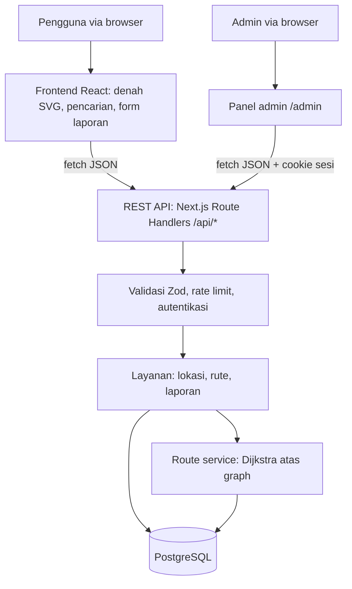

# AksesKampus

Temukan ruangan, pahami denah, dan cari rute di dalam kampus.

AksesKampus adalah website navigasi indoor berbasis denah 2D interaktif dan REST API. Studi kasus awal: **Lantai 1 BINUS Anggrek (Kemanggisan)**. Dibuat untuk Web Development Competition UINIC 8.0, subtema **Pendidikan**.

> **Status data:** nama lokasi diambil dari denah referensi dan **belum diverifikasi di lapangan**. Koordinat titik dan jalur adalah **simulasi demo**. Aplikasi menampilkan status ini secara terbuka di setiap lokasi dan rute. Jangan gunakan rute berlabel "Simulasi" sebagai petunjuk jalan yang pasti.

## Fitur

| Fitur | Keterangan |
|---|---|
| Denah 2D interaktif | Geser, perbesar (roda mouse, cubit di ponsel, tombol), penanda lokasi yang bisa diklik dan dipilih dengan keyboard |
| Pencarian lokasi | Cari berdasarkan nama, singkatan, atau kata kunci (mis. "perpus" menemukan LKC), filter jenis fasilitas |
| Detail lokasi | Nama, jenis, deskripsi, status verifikasi, sumber data, tanggal pembaruan |
| Cari rute | Algoritma **Dijkstra** di server atas graph koridor yang tersimpan di database; garis rute + instruksi teks langkah demi langkah |
| Kejujuran data | Rute berstatus `simulation`, `verified`, atau `needs_review`; bila graph tidak menghubungkan dua titik, server mengembalikan `route_unavailable` dan **tidak ada garis tebakan** |
| Laporan koreksi | Pengguna (tanpa login) melaporkan nama salah, ruangan pindah, fasilitas berubah, atau ruang baru |
| Verifikasi admin | Admin login, meninjau, menyetujui/menolak; perubahan baru tampil setelah disetujui; perubahan posisi menandai rute terkait perlu verifikasi ulang |
| Tautan yang bisa dibagikan | `/?from=lobby&to=lkc` langsung membuka rute; dasar untuk QR code titik awal |
| Responsif | Desktop (panel + peta) dan ponsel (peta di atas, rute dan pencarian di bawah) |

## Teknologi

| Lapisan | Pilihan |
|---|---|
| Framework | Next.js 16 (App Router, Route Handlers sebagai REST API), React 19, TypeScript |
| Tampilan | Tailwind CSS 4, SVG overlay untuk peta, font Plus Jakarta Sans |
| Database | PostgreSQL (Neon untuk produksi) dengan Drizzle ORM dan migrasi SQL |
| Validasi & keamanan | Zod, bcrypt, JWT (jose) dalam cookie HttpOnly, rate limiting berbasis database |
| Hosting | Vercel (aplikasi) + Neon (database) |

## Arsitektur



Frontend **tidak** mengakses database langsung; semua data lewat REST API, sehingga API yang sama bisa dipakai aplikasi lain (mis. aplikasi mobile atau kios informasi kampus).

### Model data

`buildings` → `floors` → `locations`, `route_nodes`, `route_edges`; `reports` → `locations`; `admins`; `audit_logs`; `rate_limits`. Skema lengkap: [`src/db/schema.ts`](src/db/schema.ts), migrasi: [`drizzle/`](drizzle).

- Koordinat `marker_x/y` dan `route_nodes.x/y` adalah **relatif 0–1** terhadap kanvas denah, bukan GPS dan bukan meter.
- Posisi penanda (untuk UI) dipisah dari titik masuk ruangan (`entry_node_id`, untuk perhitungan rute).
- Setiap lokasi, node, dan edge punya `verification_status` (`unverified`/`verified`/`outdated`) dan `source_type` (`reference_map`/`field_verified`/`demo_simulation`).

## Struktur folder

```text
src/
  app/
    page.tsx              # halaman peta
    admin/page.tsx        # panel admin
    api/                  # REST API (lihat docs/api.md)
  components/             # FloorMap, NavigatorApp, ReportDialog, AdminApp, ...
  db/
    schema.ts             # skema tabel
    seed-data.ts          # data lokasi, node, edge lantai 1
    seed.ts               # sinkronisasi seed + akun admin
  lib/
    routing.ts            # Dijkstra + instruksi belok (fungsi murni, diuji)
    validation.ts         # skema Zod untuk semua input
    auth.ts               # sesi admin (JWT, cookie HttpOnly)
    rate-limit.ts         # pembatas laju berbasis Postgres
  server/                 # logika lokasi, rute, laporan
drizzle/                  # migrasi SQL
scripts/db-setup.ts       # migrasi + seed (dijalankan otomatis sebelum build)
tests/                    # unit test
docs/                     # dokumentasi API, sumber data, pengujian
```

## Menjalankan secara lokal

Prasyarat: Node.js 20.9+ dan PostgreSQL (lokal atau Neon).

```bash
git clone https://github.com/<username>/akses-kampus.git
cd akses-kampus
npm install
cp .env.example .env      # isi DATABASE_URL, AUTH_SECRET, ADMIN_EMAIL, ADMIN_PASSWORD
npm run db:setup          # migrasi + data awal + akun admin
npm run dev               # buka http://localhost:3000
```

Perintah lain:

| Perintah | Fungsi |
|---|---|
| `npm test` | Menjalankan unit test algoritma rute |
| `npm run lint` | Pemeriksaan kode |
| `npm run build` | Migrasi + seed (bila `DATABASE_URL` ada) lalu build produksi |
| `npm run db:reseed` | Memaksa sinkronisasi ulang data peta dari `seed-data.ts` |
| `npm run db:generate` | Membuat file migrasi baru setelah `schema.ts` diubah |

## Deploy (Vercel + Neon)

1. Buat project di [Neon](https://neon.com) (region Singapore), salin *connection string*.
2. Di [Vercel](https://vercel.com), **Add New → Project**, impor repository ini.
3. Isi *Environment Variables*: `DATABASE_URL`, `AUTH_SECRET` (≥ 32 karakter acak), `ADMIN_EMAIL`, `ADMIN_PASSWORD` (≥ 10 karakter), `ADMIN_NAME`.
4. Klik **Deploy**. Script build otomatis menjalankan migrasi, mengisi data awal, dan membuat akun admin.
5. Cek `https://<domain>/api/health` → `{"status":"ok","database":"ok"}`.

## Panduan penggunaan

**Mencari ruangan**
1. Ketik nama atau kata kunci di kolom *Cari ruangan atau fasilitas* (contoh: `LKC`, `perpus`, `bank`), atau pilih filter jenis.
2. Pilih hasil; peta memperbesar ke lokasi itu dan menampilkan detailnya, termasuk status verifikasi.

**Mencari rute**
1. Pilih lokasi di *Dari* dan *Ke* (atau dari kartu detail: *Mulai dari sini* / *Rute ke sini*).
2. Tekan **Cari rute**. Garis kuning bergaris hitam berarti **rute simulasi**; garis kuning penuh berarti rute terverifikasi.
3. Ikuti instruksi teks di panel. Bila muncul *Rute belum tersedia*, koridor ke lokasi tersebut memang belum dipetakan.

**Melaporkan perubahan**
1. Buka detail lokasi → **Laporkan perubahan** (atau *Laporkan ruang* di header untuk ruang yang belum ada).
2. Pilih jenis laporan, tulis apa yang berbeda, kirim. Laporan menunggu peninjauan admin; peta belum berubah.

**Admin**
1. Buka `/admin`, masuk dengan akun admin.
2. Tab *Laporan*: tinjau laporan, sesuaikan data lokasi, lalu **Setujui dan terapkan** atau **Tolak**.
3. Tab *Data lokasi*: ubah nama, deskripsi, posisi penanda, dan status verifikasi secara langsung. Semua perubahan tercatat di `audit_logs`.

## Keamanan

- Validasi semua input di server dengan Zod (panjang, tipe, enum, karakter kontrol dibersihkan).
- Endpoint admin wajib sesi valid (JWT HS256, cookie `HttpOnly`, `SameSite=Strict`, `Secure` di produksi, kedaluwarsa 8 jam); tanpa sesi → `401`.
- Password admin di-hash dengan bcrypt (cost 12); login dibatasi 8 percobaan per 15 menit per IP.
- Laporan dibatasi 5 per 10 menit per IP; IP disimpan sebagai hash SHA-256, bukan IP mentah; ada honeypot anti-bot.
- Pemeriksaan header `Origin` untuk request yang mengubah data, hanya menerima `application/json`, batas ukuran body.
- Query database memakai parameter (Drizzle), wildcard pencarian di-escape.
- Header keamanan: `X-Frame-Options`, `X-Content-Type-Options`, `Referrer-Policy`, `Permissions-Policy`, HSTS.
- Error internal tidak dikirim ke klien; format error seragam `{ error: { code, message, details? } }`.

## Batasan MVP

- Satu gedung, satu lantai. Belum ada navigasi lintas lantai, GPS/BLE positioning, AI, atau peta 3D.
- Jarak hanya dalam unit peta relatif; tidak ada estimasi meter atau waktu tempuh sebelum skala dikalibrasi.
- Tidak ada klaim rute ramah kursi roda sebelum audit aksesibilitas fisik.

## Pengembangan berikutnya

Kalibrasi denah dan verifikasi lapangan, lantai 2+ dengan koneksi lift/eskalator, QR code titik awal, profil rute aksesibilitas berbasis data terverifikasi, foto interior berizin, dan antarmuka AI **di atas** data dan layanan rute yang sama.

## Dokumentasi lain

- [Dokumentasi REST API](docs/api.md)
- [Sumber dan kebijakan data](docs/data-sources.md)
- [Pengujian](docs/testing.md)
